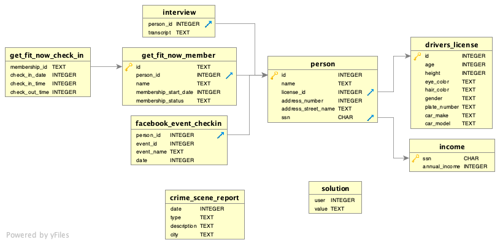

## Plot
A crime has taken place and the detective needs your help. The detective gave you the crime scene report, but you somehow lost it. You vaguely remember that the crime was a `​murder​` that occurred sometime on `​Jan.15, 2018` (15/01/2018 )​ and that it took place in `​SQL City`​. Start by retrieving the corresponding crime scene report from the police department’s database. 

## Exploring the Database Structure
Experienced SQL users can often use database queries to infer the structure of a database. But each database system has different ways of managing this information. The SQL Murder Mystery is built using SQLite. Use this SQL command to find the tables in the Murder Mystery database. 

Run this query to find the names of the tables in this database.
> This command is specific to SQLite. For other databases, you'll have to learn their specific syntax.
```sql
SELECT name 
  FROM sqlite_master
where type = 'table'
```   
#### `output`:  
```
- name
crime_scene_report
drivers_license
facebook_event_checkin
interview
get_fit_now_member
get_fit_now_check_in
solution
income
person
```


Besides knowing the table names, you need to know how each table is structured. The way this works is also dependent upon which database technology you use. Here's how you do it with SQLite.  
- 01. `crime_scene_report`  
```sql
CREATE TABLE crime_scene_report 
( 
    date integer, 
    type text, 
    description text,
    city text 
)
```     
- 02. `drivers_license`
```sql
CREATE TABLE drivers_license 
( 
    id integer PRIMARY KEY, 
    age integer, 
    height integer, 
    eye_color text, 
    hair_color text, 
    gender text, 
    plate_number text, 
    car_make text, 
    car_model text 
)
```   
- 03. `facebook_event_checkin`
```sql
CREATE TABLE facebook_event_checkin 
( 
    person_id integer, 
    event_id integer, 
    event_name text, 
    date integer, 
    FOREIGN KEY (person_id) REFERENCES person(id) 
)
```   
- 04. `interview`  
```sql
CREATE TABLE interview 
( 
    person_id integer, 
    transcript text, 
    FOREIGN KEY (person_id) REFERENCES person(id) 
)
```   
- 05. `get_fit_now_member`  
```sql
CREATE TABLE get_fit_now_member 
( 
    id text PRIMARY KEY, 
    person_id integer, 
    name text, 
    membership_start_date integer, 
    membership_status text, 
    FOREIGN KEY (person_id) REFERENCES person(id) 
)
```   
- 06. `get_fit_now_check_in`
```sql
CREATE TABLE get_fit_now_check_in 
( 
    membership_id text, 
    check_in_date integer, 
    check_in_time integer, 
    check_out_time integer, 
    FOREIGN KEY (membership_id) REFERENCES get_fit_now_member(id) 
)
```   
- 07. `solution`
```sql
CREATE TABLE solution 
(
    user integer, value text 
)
```   
- 08. `income`   
```sql
CREATE TABLE income 
(
    ssn CHAR PRIMARY KEY, 
    annual_income integer
)
```   
- 09. `person`
```sql
CREATE TABLE person 
(
    id integer PRIMARY KEY, 
    name text, 
    license_id integer, 
    address_number integer, 
    address_street_name text, 
    ssn CHAR REFERENCES income (ssn), 
    FOREIGN KEY (license_id) REFERENCES drivers_license (id)
)
```   
### The rest is up to you!
If you're really comfortable with SQL, you can probably get it from here. 
  
Use your knowledge of the database schema and SQL commands to find out who committed the murder.  
When you think you know the answer, go to the next section below.  
```sql

```   