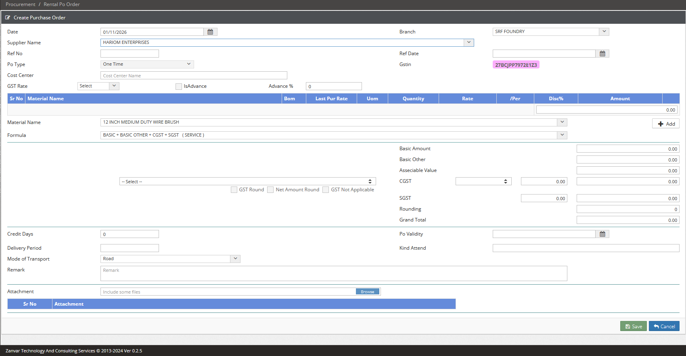

# While Work
## Date: `31-10-2026 (Saturday | शनिवार)` to `01-11-2026 (Sunday | रविवार)`
## A. Menu Images
### Images: 
- `Suppliers` => `Material` ddl

## B. Work Section
```yml
Menu Path   : 
                - Procurement => Purchase Order => Rental Po Order => Create
                (Supplier ddl based on new I_BOM_SUP, & based on SubGlAcNo following Material ddl, overflowY auto)
                - Procurement => Approve => Rental Po Order (old bug fixing)
                - 
```  
## C. Database
#### New Tables
```yml
Tables     : 
```  
#### New Tables
```yml
SPs        : 
```
#### New column in old tables 
```yml

```
## D. Programming
`WFC` - 
```yml
D to D      : 
BO          : 
Controller  : 
View        : 
```  
## E. Git
```yml
Push Date   : 
```  

----------------------------------------------------------------------------------------------------    
